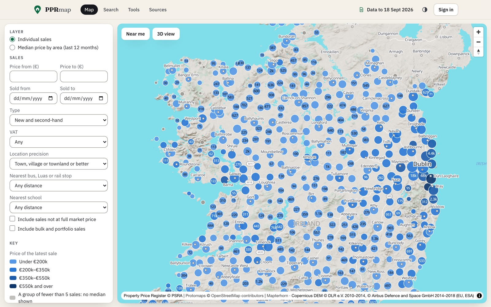

# PPR Map

The Property Price Register, made usable: every residential sale in Ireland since 2010 on a map, with honest geocoding, sale history and vicinity context.



## In numbers

| | |
|---|---|
| Sales | **807,724** (2010-01-01 to 2026-09-18) on 728,386 properties |
| Geocoded | **57%** to the exact address or street, **91%** to town, village or townland or better; every point says which |
| Context | 73,808 areas, 65,800 points of interest, a 638,778-feature local street gazetteer |
| Tests | 461 unit tests (backend, pipeline, frontend), 60 Playwright route checks; mypy strict and TypeScript strict |

Figures are from the local data version `2026-09-18.r40.a50` ([progress.md](progress.md)).

## What makes it different

- **Honest locations.** The register has no coordinates, and 21% of its addresses contain no number at all. Each sale is geocoded by a cascade (self-hosted Nominatim, a local street gazetteer, then official places), and the map shows the precision of every point instead of pretending it is exact.
- **The raw file, read properly.** The CSV is Windows-1252, not UTF-8. Fadas, the euro sign and Irish-language descriptions survive, and the raw value is kept beside every parsed one.
- **Market prices by default.** Sales not at full market price and bulk or portfolio sales are left out of the map and statistics unless you include them, and VAT-exclusive new-build prices are labelled as filed.
- **Statistics that hold up.** Medians of fewer than 5 sales are suppressed, and the latest two months are marked provisional.
- **No owner data.** Nothing that could identify owners or occupants is joined, and anyone can ask for a home to be hidden.

## Features

Map explorer with a synced list view, search, property pages with sale history and nearby transport and schools, area pages, a stamp duty and an affordability calculator, an index-based price estimate with comparables, accounts with wishlists, saved searches and email alerts, and an admin area.

## Stack

PostgreSQL 16 + PostGIS, FastAPI (Python 3.12, SQLAlchemy 2, Pydantic v2), a Typer pipeline run by RQ workers, Martin vector tiles and PMTiles, Next.js 16 with React 19, Tailwind CSS v4 and MapLibre GL JS, self-hosted Nominatim, Redis and Caddy, all in Docker Compose. See [architecture.md](architecture.md).

## Status

Phase 5 (search, area pages, saved searches and alerts, calculators, admin, estimate and comparables) is complete and awaiting review, with the P0 to P2 bugs from its review fixed. See [progress.md](progress.md) and [task.md](task.md).

**Live preview:** https://ppr-map.vercel.app/ is the frontend as a static site on Vercel, deployed from `main`. It has no data yet, so it shows the page layout only; a static site with the full data is being built. The screenshot above is the full app running locally.

## Quick start

Prerequisites: Python 3.12, Node 22 LTS, and Docker (Docker Desktop or OrbStack).

```bash
make env          # .env with random local secrets
make install      # Python venv + npm packages
make up           # PostGIS, Redis, API, Martin, Next.js, Caddy, Mailpit
make migrate      # schema, database role passwords, roles/permissions
open http://localhost:8080
```

In development no email leaves your computer: verification, password reset and alert emails are caught by Mailpit at http://localhost:8025, whatever address you register with.

To fill the map with real data (first run: about 2 hours, mostly geocoding):

```bash
.venv/bin/ppr ingest tailte_boundaries   # counties, EDs, Small Areas, townlands, towns
make geocoder     # self-hosted Nominatim (first start imports Ireland; Docker memory >= 12 GB)
make pipeline     # PPR ingest, street gazetteer, geocode, enrich, aggregate
make basemap      # the Ireland basemap, terrain, fonts and sprites (~650 MB)
```

`make test` runs the unit tests; `make test-db` adds the live-database checks.

## Layout

| Folder | Contents |
|---|---|
| `backend/` | FastAPI app, SQLAlchemy models, Alembic migrations, management CLI |
| `pipeline/` | `ppr` CLI for ingest, geocoding, enrichment and aggregates (Phase 2) |
| `frontend/` | Next.js App Router, Tailwind, MapLibre; one page per route in `src/lib/routes.ts` |
| `infra/` | Docker Compose, Caddy, Martin, Postgres init |
| `config/` | `sources.yaml` (data sources and licences), `rates.yaml` (calculator rates, Phase 5) |
| `docs/` | plan, decisions, data model, API, permissions, research |

| Doc | What's in it |
|---|---|
| [goal.md](goal.md), [requirements.md](requirements.md) | the final goal and the PRD, with each feature's status |
| [architecture.md](architecture.md), [design.md](design.md) | structure, stack and integrations at a glance; the visual style |
| [progress.md](progress.md), [task.md](task.md) | where the project stands; what is done and what is next |
| [docs/research/ppr-data-profile.md](docs/research/ppr-data-profile.md) | what the real PPR file contains, verified 2026-09-26 |
| [docs/research/competitive-analysis.md](docs/research/competitive-analysis.md) | competitor review, reusable open data, how we beat them |
| [docs/ARCHITECTURE.md](docs/ARCHITECTURE.md) | system diagram, stack, data flow |
| [docs/data-model.md](docs/data-model.md) | tables, fields, indexes |
| [docs/api.md](docs/api.md) | `/api/v1` endpoints |
| [docs/permissions.md](docs/permissions.md) | roles, permission matrix, rate limits |
| [docs/external-services.md](docs/external-services.md) | every data source and service, with licence and env var |
| [docs/DECISIONS.md](docs/DECISIONS.md) | decision log |
| [docs/RISKS-AND-QUESTIONS.md](docs/RISKS-AND-QUESTIONS.md) | open questions and risks |

## Data attribution

Contains Residential Property Price Register data from the Property Services Regulatory Authority (www.propertypriceregister.ie). © PSRA. The data may contain errors and is not a property price index.
